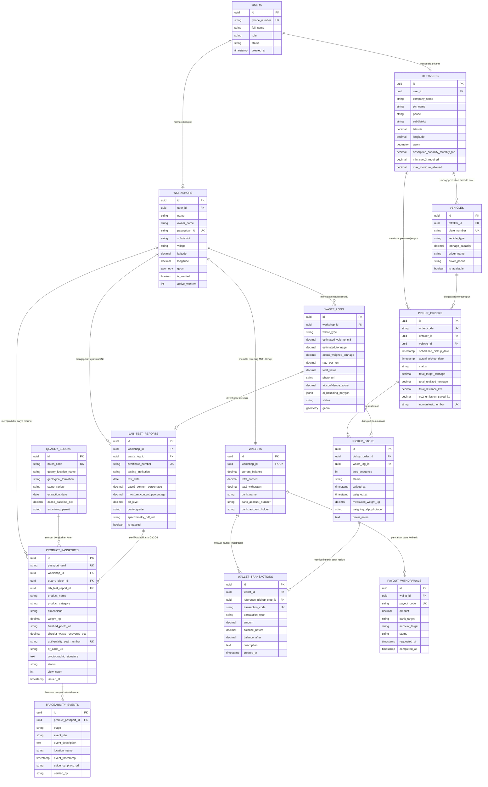

# 🏛️ Skema & Entity Relationship Diagram (ERD) SI-MUKTI
## Basis Data Geospasial, Rantai Pasok, dan Paspor Ketertelusuran Digital Marmer Tulungagung
**Platform:** SI-MUKTI (Sistem Informasi Geospasial dan Ketertelusuran Digital Marmer Tulungagung)  
**Dokumen Referensi:** [PRD.md](../PRD.md) (Versi 1.0 Baseline)  
**RDBMS Target:** PostgreSQL 16+ dengan Ekstensi PostGIS 3.4+ *(Fallback portabel: SQLite 3)*  

---

## 1. Visualisasi Diagram Hubungan Antar-Entitas (Mermaid ERD)

---

## 2. Kamus Data & Rincian Entitas (Data Dictionary)

### 2.1 Modul Akun, Profil, & Pemangku Kepentingan

#### A. Tabel `users`
Menyimpan identitas akun aktor Pentahelix yang masuk menggunakan OTP WhatsApp / Ponsel.
| Nama Kolom | Tipe Data | Constraint | Deskripsi Fungsional |
| :--- | :--- | :--- | :--- |
| `id` | UUID | PK, DEFAULT uuid_generate_v4() | ID unik pengguna sistem |
| `phone_number` | VARCHAR(20) | UNIQUE, NOT NULL | Nomor telepon/WhatsApp untuk OTP tanpa password rumit (FR-01) |
| `full_name` | VARCHAR(150) | NOT NULL | Nama lengkap pengguna |
| `role` | VARCHAR(30) | NOT NULL, CHECK in (...) | Role: `pengrajin`, `offtaker`, `regulator_pemkab`, `laboratorium`, `konsumen` |
| `status` | VARCHAR(20) | DEFAULT 'active' | Status akun: `active`, `suspended`, `pending_verification` |
| `created_at` | TIMESTAMPTZ | DEFAULT NOW() | Waktu registrasi akun |
| `updated_at` | TIMESTAMPTZ | DEFAULT NOW() | Waktu pembaruan akun |

#### B. Tabel `workshops` (Bengkel Marmer Rakyat)
Menyimpan profil fisik bengkel bubut marmer rakyat beserta titik koordinat spasial akurat (FR-01, FR-07, FR-09).
| Nama Kolom | Tipe Data | Constraint | Deskripsi Fungsional |
| :--- | :--- | :--- | :--- |
| `id` | UUID | PK, DEFAULT uuid_generate_v4() | ID unik bengkel |
| `user_id` | UUID | FK -> `users(id)`, ON DELETE CASCADE | Relasi ke akun pengguna |
| `name` | VARCHAR(200) | NOT NULL | Nama bengkel (contoh: *Bengkel Marmer Al-Barokah*) |
| `owner_name` | VARCHAR(150) | NOT NULL | Nama pemilik (contoh: *Pak Supardi*) |
| `paguyuban_id` | VARCHAR(50) | UNIQUE, NOT NULL | Nomor registrasi Paguyuban Pengrajin Marmer Tulungagung |
| `subdistrict` | VARCHAR(100) | NOT NULL | Kecamatan (Campurdarat / Besole / Boyolangu) |
| `village` | VARCHAR(100) | NOT NULL | Desa (Gamping, Sawo, Popoh, dll.) |
| `address_detail` | TEXT | | Alamat jalan / patokan bengkel |
| `latitude` | NUMERIC(10, 8) | NOT NULL | Titik lintang geospasial WGS84 |
| `longitude` | NUMERIC(11, 8) | NOT NULL | Titik bujur geospasial WGS84 |
| `geom` | GEOMETRY(Point, 4326) | SPATIAL INDEX GIST | Kolom spasial PostGIS untuk query radius & peta interaktif |
| `is_verified` | BOOLEAN | DEFAULT TRUE | Status verifikasi oleh Dinas / Paguyuban |
| `active_workers` | INTEGER | DEFAULT 3 | Jumlah tenaga kerja binaan |
| `created_at` | TIMESTAMPTZ | DEFAULT NOW() | Waktu terdaftar |

#### C. Tabel `offtakers` (Industri Pengolah & Penyerap)
Menyimpan identitas pabrik pengolah (pabrik paving, teraso, kapur pertanian/pupuk kalsium).
| Nama Kolom | Tipe Data | Constraint | Deskripsi Fungsional |
| :--- | :--- | :--- | :--- |
| `id` | UUID | PK, DEFAULT uuid_generate_v4() | ID unik offtaker |
| `user_id` | UUID | FK -> `users(id)` | Relasi ke akun penanggung jawab |
| `company_name` | VARCHAR(200) | NOT NULL | Nama entitas (contoh: *PT Sentosa Teraso & Paving*) |
| `pic_name` | VARCHAR(150) | NOT NULL | Nama Person in Charge / Manajer Operasional (*Hendra Wijaya*) |
| `phone` | VARCHAR(20) | NOT NULL | Nomor kontak operasional |
| `subdistrict` | VARCHAR(100) | NOT NULL | Kecamatan lokasi fasilitas pengolahan |
| `latitude` | NUMERIC(10, 8) | NOT NULL | Koordinat latitude fasilitas pabrik |
| `longitude` | NUMERIC(11, 8) | NOT NULL | Koordinat longitude fasilitas pabrik |
| `geom` | GEOMETRY(Point, 4326) | SPATIAL INDEX GIST | Titik PostGIS untuk penghitungan jarak rute truk penjemput |
| `absorption_capacity_monthly_ton`| NUMERIC(10, 2) | DEFAULT 150.00 | Kapasitas serapan per bulan (ton) |
| `min_caco3_required` | NUMERIC(5, 2) | DEFAULT 95.00 | Standar minimal kemurnian kalsit $\text{CaCO}_3$ (%) |
| `max_moisture_allowed`| NUMERIC(5, 2) | DEFAULT 20.00 | Batas maksimal kadar air residu (%) |

#### D. Tabel `vehicles` (Armada Truk Dump Offtaker)
| Nama Kolom | Tipe Data | Constraint | Deskripsi Fungsional |
| :--- | :--- | :--- | :--- |
| `id` | UUID | PK, DEFAULT uuid_generate_v4() | ID unik armada |
| `offtaker_id` | UUID | FK -> `offtakers(id)` | Perusahaan pemilik armada |
| `plate_number` | VARCHAR(20) | UNIQUE, NOT NULL | Nomor polisi (contoh: *AG 8492 UT*) |
| `vehicle_type` | VARCHAR(50) | NOT NULL | Jenis kendaraan (*Dump Truck 6-Wheeler*) |
| `tonnage_capacity` | NUMERIC(6, 2) | NOT NULL | Kapasitas muatan maksimal (contoh: 6.00 ton) |
| `driver_name` | VARCHAR(100) | NOT NULL | Nama pengemudi |
| `driver_phone` | VARCHAR(20) | NOT NULL | Nomor telepon / WhatsApp pengemudi (FR-05) |
| `is_available` | BOOLEAN | DEFAULT TRUE | Status ketersediaan armada |

---

### 2.2 Modul Pencatatan Residu, AI Volumetrik & Uji Lab

#### E. Tabel `waste_logs` (Pencatatan Residu Limbah)
Mencatat stok residu limbah marmer yang siap divalorisasi (FR-03, FR-04, FR-08).
| Nama Kolom | Tipe Data | Constraint | Deskripsi Fungsional |
| :--- | :--- | :--- | :--- |
| `id` | UUID | PK, DEFAULT uuid_generate_v4() | ID unik log residu |
| `workshop_id` | UUID | FK -> `workshops(id)` | Bengkel asal residu |
| `waste_type` | VARCHAR(30) | NOT NULL, CHECK in (...) | `sludge_lumpur` (lumpur bubut) atau `afur_kasar` (pecahan batu) |
| `estimated_volume_m3` | NUMERIC(8, 3) | NOT NULL | Estimasi volume kubikasi ($m^3$) hasil scan kamera AI |
| `estimated_tonnage` | NUMERIC(8, 2) | NOT NULL | Estimasi berat basah (ton) |
| `actual_weighed_tonnage` | NUMERIC(8, 2) | NULL | Berat nyata hasil timbang jembatan timbang/dinas |
| `rate_per_ton` | NUMERIC(12, 2) | DEFAULT 150000.00 | Tarif kesepakatan per ton (standar Rp 150.000 / ton) |
| `total_value` | NUMERIC(12, 2) | NOT NULL | Nilai rupiah kalkulasi (Tonase $\times$ Tarif) |
| `photo_url` | VARCHAR(500) | NOT NULL | Tautan foto tumpukan limbah ber-geotag |
| `ai_confidence_score` | NUMERIC(4, 3) | DEFAULT 0.950 | Tingkat akurasi deteksi model kontur AI |
| `ai_bounding_polygon` | JSONB | | Koordinat poligon 3D mesh deteksi kubikasi |
| `status` | VARCHAR(30) | DEFAULT 'tersedia' | Status: `tersedia`, `dijadwalkan`, `terangkut`, `terserap_pabrik` |
| `geom` | GEOMETRY(Point, 4326) | SPATIAL INDEX GIST | Titik koordinat tumpukan limbah untuk layer Web-GIS |

#### F. Tabel `lab_test_reports` (Sertifikasi Spektrometri SNI 03-0394)
Menyimpan sertifikat pengujian laboratorium resmi (FR-09, FR-14).
| Nama Kolom | Tipe Data | Constraint | Deskripsi Fungsional |
| :--- | :--- | :--- | :--- |
| `id` | UUID | PK, DEFAULT uuid_generate_v4() | ID unik hasil uji |
| `workshop_id` | UUID | FK -> `workshops(id)` | Bengkel yang diuji |
| `waste_log_id` | UUID | FK -> `waste_logs(id)`, NULL | Referensi sampel limbah |
| `certificate_number` | VARCHAR(100) | UNIQUE, NOT NULL | Nomor sertifikat uji (contoh: *LAB-SNI-2026/0394-081*) |
| `testing_institution` | VARCHAR(200) | NOT NULL | Lembaga penguji (Balai Standardisasi Jatim / Lab Geologi) |
| `test_date` | DATE | NOT NULL | Tanggal pengujian |
| `caco3_content_percentage` | NUMERIC(5, 2) | NOT NULL | Kadar Kalsium Karbonat ($\text{CaCO}_3 \ge 95\%$) |
| `moisture_content_percentage` | NUMERIC(5, 2) | NOT NULL | Kadar kelembapan air (%) |
| `ph_level` | NUMERIC(4, 2) | NOT NULL | Tingkat pH (standar 7.5 – 8.5) |
| `purity_grade` | VARCHAR(50) | NOT NULL | Predikat mutu: *Grade A Super Kalsit*, *Grade B*, dst. |
| `spectrometry_pdf_url` | VARCHAR(500) | | Tautan file dokumen PDF hasil uji laboratorium |
| `is_passed` | BOOLEAN | DEFAULT TRUE | Status kelulusan standar SNI 03-0394 |

---

### 2.3 Modul Logistik Cerdas, Multi-Stop & e-Manifest

#### G. Tabel `pickup_orders` (Pesanan Penjemputan Truk Dump)
Mengorkestrasi penugasan armada truk offtaker untuk mengambil limbah ke bengkel-bengkel (FR-05, FR-10).
| Nama Kolom | Tipe Data | Constraint | Deskripsi Fungsional |
| :--- | :--- | :--- | :--- |
| `id` | UUID | PK, DEFAULT uuid_generate_v4() | ID unik order penjemputan |
| `order_code` | VARCHAR(50) | UNIQUE, NOT NULL | Kode ritase (contoh: *TRK-20261022-001*) |
| `offtaker_id` | UUID | FK -> `offtakers(id)` | Industri pembeli residu |
| `vehicle_id` | UUID | FK -> `vehicles(id)` | Truk yang ditugaskan |
| `scheduled_pickup_date` | TIMESTAMPTZ | NOT NULL | Jadwal keberangkatan penjemputan |
| `actual_pickup_date` | TIMESTAMPTZ | NULL | Waktu nyata truk kembali ke pabrik |
| `status` | VARCHAR(30) | DEFAULT 'menunggu_sopir'| `menunggu_sopir`, `dalam_perjalanan`, `tiba_di_lokasi`, `selesai`, `dibatalkan` |
| `total_target_tonnage` | NUMERIC(8, 2) | NOT NULL | Target total muatan (ton) |
| `total_realized_tonnage`| NUMERIC(8, 2) | DEFAULT 0.00 | Realisasi total muatan yang berhasil diangkut |
| `total_distance_km` | NUMERIC(6, 2) | | Estimasi total jarak tempuh multi-stop (km) |
| `co2_emission_saved_kg` | NUMERIC(10, 2) | | Estimasi reduksi emisi $\text{CO}_2$ eq logistik teroptimasi |
| `e_manifest_number` | VARCHAR(100) | UNIQUE, NOT NULL | Nomor Surat Jalan Digital / e-Manifest resmi Dinas |

#### H. Tabel `pickup_stops` (Titik Singgah Multi-Stop Bengkel)
Mencatat urutan bengkel yang dikunjungi truk dalam satu kali ritase perjalanan (FR-10).
| Nama Kolom | Tipe Data | Constraint | Deskripsi Fungsional |
| :--- | :--- | :--- | :--- |
| `id` | UUID | PK, DEFAULT uuid_generate_v4() | ID unik stop point |
| `pickup_order_id` | UUID | FK -> `pickup_orders(id)` | Order penjemputan induk |
| `waste_log_id` | UUID | FK -> `waste_logs(id)` | Tumpukan residu yang dimuat |
| `stop_sequence` | INTEGER | NOT NULL | Urutan stop rute (1, 2, 3...) |
| `status` | VARCHAR(30) | DEFAULT 'menunggu' | Status: `menunggu`, `tiba`, `timbang_muat`, `selesai_muat` |
| `arrived_at` | TIMESTAMPTZ | NULL | Waktu tiba di bengkel pengrajin |
| `weighed_at` | TIMESTAMPTZ | NULL | Waktu penimbangan selesai |
| `measured_weight_kg` | NUMERIC(8, 2) | NULL | Berat riil yang dimuat (kg) |
| `weighing_slip_photo_url`| VARCHAR(500) | NULL | Foto struk jembatan timbang / meteran digital |
| `driver_notes` | TEXT | | Catatan sopir (misal: "Akses jalan sempit") |

---

### 2.4 Modul Keuangan Digital (MUKTI-Pay Ledger)

#### I. Tabel `wallets` (Buku Kas & Saldo Pengrajin)
Mencatat saldo rupiah valorisasi limbah milik pengrajin (FR-02, FR-06).
| Nama Kolom | Tipe Data | Constraint | Deskripsi Fungsional |
| :--- | :--- | :--- | :--- |
| `id` | UUID | PK, DEFAULT uuid_generate_v4() | ID unik dompet |
| `workshop_id` | UUID | FK -> `workshops(id)`, UNIQUE | Satu bengkel memiliki satu dompet |
| `current_balance` | NUMERIC(14, 2) | DEFAULT 0.00 | Saldo aktif yang siap dicairkan (Rp) |
| `total_earned` | NUMERIC(14, 2) | DEFAULT 0.00 | Akumulasi pendapatan kotor dari limbah |
| `total_withdrawn` | NUMERIC(14, 2) | DEFAULT 0.00 | Akumulasi dana yang telah ditarik ke bank |
| `bank_name` | VARCHAR(100) | DEFAULT 'Bank Jatim' | Bank tujuan transfer (Bank Jatim / BRI / BNI / Mandiri) |
| `bank_account_number` | VARCHAR(50) | NOT NULL | Nomor rekening pengrajin |
| `bank_account_holder` | VARCHAR(150) | NOT NULL | Nama pemilik rekening sesuai buku tabungan |

#### J. Tabel `wallet_transactions` (Jurnal Mutasi Keuangan)
| Nama Kolom | Tipe Data | Constraint | Deskripsi Fungsional |
| :--- | :--- | :--- | :--- |
| `id` | UUID | PK, DEFAULT uuid_generate_v4() | ID unik transaksi |
| `wallet_id` | UUID | FK -> `wallets(id)` | Dompet bersangkutan |
| `reference_pickup_stop_id`| UUID | FK -> `pickup_stops(id)`, NULL| Transaksi penjemputan limbah terkait |
| `transaction_code` | VARCHAR(50) | UNIQUE, NOT NULL | Kode transaksi (contoh: *TX-MKT-20261022-0042*) |
| `transaction_type` | VARCHAR(30) | NOT NULL | `kredit_valorisasi`, `penarikan_dana`, `penyesuaian` |
| `amount` | NUMERIC(14, 2) | NOT NULL | Nominal mutasi rupiah |
| `balance_before` | NUMERIC(14, 2) | NOT NULL | Saldo sebelum transaksi |
| `balance_after` | NUMERIC(14, 2) | NOT NULL | Saldo setelah transaksi |
| `description` | TEXT | NOT NULL | Keterangan mutasi |
| `created_at` | TIMESTAMPTZ | DEFAULT NOW() | Waktu pencatatan mutasi |

#### K. Tabel `payout_withdrawals` (Pengajuan Tarik Dana ke Bank)
| Nama Kolom | Tipe Data | Constraint | Deskripsi Fungsional |
| :--- | :--- | :--- | :--- |
| `id` | UUID | PK, DEFAULT uuid_generate_v4() | ID pengajuan penarikan |
| `wallet_id` | UUID | FK -> `wallets(id)` | Dompet pengrajin pemohon |
| `payout_code` | VARCHAR(50) | UNIQUE, NOT NULL | Kode payout (contoh: *WD-20261022-019*) |
| `amount` | NUMERIC(14, 2) | NOT NULL, CHECK > 0 | Nominal penarikan dana |
| `bank_target` | VARCHAR(100) | NOT NULL | Nama bank tujuan |
| `account_target` | VARCHAR(50) | NOT NULL | Nomor rekening tujuan transfer |
| `status` | VARCHAR(20) | DEFAULT 'pending' | `pending`, `processing`, `success`, `rejected` |
| `transfer_receipt_url` | VARCHAR(500) | NULL | Foto bukti transfer resmi dari bank |
| `requested_at` | TIMESTAMPTZ | DEFAULT NOW() | Waktu pengajuan tarik saldo |
| `completed_at` | TIMESTAMPTZ | NULL | Waktu transfer dana sukses |

---

### 2.5 Modul Ketertelusuran Asal Usul & Paspor Digital (MUKTI-Trace)

#### L. Tabel `quarry_blocks` (Bongkahan Asal Kuari Marmer Alam)
Menyimpan data asal-usul geologis batuan alam asli Tulungagung dari blok penambangan resmi (FR-12, FR-15).
| Nama Kolom | Tipe Data | Constraint | Deskripsi Fungsional |
| :--- | :--- | :--- | :--- |
| `id` | UUID | PK, DEFAULT uuid_generate_v4() | ID unik blok kuari |
| `batch_code` | VARCHAR(50) | UNIQUE, NOT NULL | Kode seri blok (contoh: *QRY-BSL-2026-X8*) |
| `quarry_location_name` | VARCHAR(200) | NOT NULL | Lokasi kuari (*Kuari Marmer Selatan Besole Blok 4*) |
| `geological_formation` | VARCHAR(150) | NOT NULL | Formasi batuan (*Formasi Wonosari Karst Tulungagung*) |
| `stone_variety` | VARCHAR(100) | NOT NULL | Jenis batuan (*Kalsit Onyx Tembus Cahaya / Java Cream*) |
| `extraction_date` | DATE | NOT NULL | Tanggal ekstraksi bongkahan dari tebing tambang |
| `caco3_baseline_pct` | NUMERIC(5, 2) | NOT NULL | Baseline kadar $\text{CaCO}_3$ formasi geologis (> 97%) |
| `sn_mining_permit` | VARCHAR(100) | NOT NULL | Nomor Izin Usaha Pertambangan (IUP / SIPB resmi) |

#### M. Tabel `product_passports` (Paspor Digital Produk Bersertifikat)
Menyimpan paspor digital terenkripsi anti-pemalsuan untuk setiap karya seni/produk marmer pengrajin (FR-12, FR-13, FR-14, FR-15).
| Nama Kolom | Tipe Data | Constraint | Deskripsi Fungsional |
| :--- | :--- | :--- | :--- |
| `id` | UUID | PK, DEFAULT uuid_generate_v4() | ID unik paspor |
| `passport_uuid` | VARCHAR(64) | UNIQUE, NOT NULL | Hash token publik 64-karakter untuk URL pemindaian QR |
| `workshop_id` | UUID | FK -> `workshops(id)` | Pengrajin lokal pembuat karya |
| `quarry_block_id` | UUID | FK -> `quarry_blocks(id)` | Referensi bongkahan kuari batu alam asal |
| `lab_test_report_id` | UUID | FK -> `lab_test_reports(id)` | Bukti sertifikat uji laboratorium |
| `product_name` | VARCHAR(200) | NOT NULL | Nama karya (contoh: *Meja Bundar Solid Onyx Tulungagung*) |
| `product_category` | VARCHAR(100) | NOT NULL | Kategori (*Furniture & Dekorasi Interior*) |
| `dimensions` | VARCHAR(100) | NOT NULL | Dimensi ukuran fisik (*D: 120cm x T: 75cm, Tebal: 4cm*) |
| `weight_kg` | NUMERIC(8, 2) | NOT NULL | Berat netto produk jadi (kg) |
| `finished_photo_url` | VARCHAR(500) | NOT NULL | Foto karya marmer resolusi tinggi |
| `circular_waste_recovered_pct`| NUMERIC(5, 2) | DEFAULT 100.00 | Porsi residu sirkular yang berhasil terserap pabrik (FR-13) |
| `authenticity_seal_number`| VARCHAR(100) | UNIQUE, NOT NULL | Nomor registrasi stempel resmi Pemkab Tulungagung |
| `qr_code_url` | VARCHAR(500) | NOT NULL | Tautan gambar stiker QR fisik anti-luntur |
| `cryptographic_signature`| TEXT | NOT NULL | Signed Hash (SHA-256 + HMAC secret dinas) |
| `status` | VARCHAR(30) | DEFAULT 'aktif' | `draft`, `aktif`, `terverifikasi`, `dicabut` |
| `view_count` | INTEGER | DEFAULT 0 | Jumlah pemindaian kode QR oleh publik |
| `issued_at` | TIMESTAMPTZ | DEFAULT NOW() | Tanggal terbit paspor |

#### N. Tabel `traceability_events` (Linimasa Jejak Rantai Pasok)
Menyajikan linimasa rantai pasok kronologis saat konsumen memindai kode QR (FR-15).
| Nama Kolom | Tipe Data | Constraint | Deskripsi Fungsional |
| :--- | :--- | :--- | :--- |
| `id` | UUID | PK, DEFAULT uuid_generate_v4() | ID event linimasa |
| `product_passport_id` | UUID | FK -> `product_passports(id)` | Paspor produk terkait |
| `stage` | VARCHAR(50) | NOT NULL | Tahapan: `kuari_tambang`, `bengkel_bubut`, `uji_mutu_lab`, `residu_terserap`, `pasar_konsumen` |
| `event_title` | VARCHAR(200) | NOT NULL | Judul peristiwa (*Ekstraksi Bongkahan Marmer Asli*) |
| `event_description` | TEXT | NOT NULL | Penjelasan detail proses kerja pengrajin |
| `location_name` | VARCHAR(200) | NOT NULL | Lokasi peristiwa terjadi (*Desa Besole, Tulungagung*) |
| `event_timestamp` | TIMESTAMPTZ | NOT NULL | Waktu kejadian |
| `evidence_photo_url` | VARCHAR(500) | | Foto bukti dokumentasi tahapan |
| `verified_by` | VARCHAR(100) | NOT NULL | Pihak yang memvalidasi (Nama Kepala Paguyuban/Inspektor) |

---

### 2.6 Modul Analitik Dampak Lingkungan & Neraca Daerah

#### O. Tabel `regional_environmental_metrics`
Menyimpan agregat analitik untuk panel telemetri Pemkab Tulungagung (FR-11).
| Nama Kolom | Tipe Data | Constraint | Deskripsi Fungsional |
| :--- | :--- | :--- | :--- |
| `id` | UUID | PK, DEFAULT uuid_generate_v4() | ID analitik agregat |
| `period_month` | DATE | NOT NULL | Bulan periode pencatatan (contoh: *2026-10-01*) |
| `subdistrict` | VARCHAR(100) | NOT NULL | Kecamatan (Campurdarat / Besole) |
| `total_waste_generated_tons` | NUMERIC(10, 2) | NOT NULL | Total timbulan residu tercatat (ton) |
| `total_waste_absorbed_tons` | NUMERIC(10, 2) | NOT NULL | Total residu terserap industri paving/teraso (ton) |
| `river_dumping_prevented_tons`| NUMERIC(10, 2) | NOT NULL | Estimasi pencegahan sedimentasi ke DAS Ngrowo (ton) |
| `carbon_emissions_reduced_kg`| NUMERIC(10, 2) | NOT NULL | Penurunan jejak karbon logistik ($\text{kg CO}_2 \text{ eq}$) |
| `economic_surplus_generated_idr`| NUMERIC(14, 2) | NOT NULL | Nilai surplus ekonomi gabungan pengrajin (Rp) |
| `active_participating_workshops`| INTEGER | NOT NULL | Jumlah bengkel yang aktif menyetor residu |

---

## 3. Strategi Pengindeksan & Kinerja Spasial (Indexes)

1. **Indeks Spasial GIST (PostGIS):**
   - `idx_workshops_geom` ON `workshops USING GIST(geom)` — Menjamin pencarian bengkel dalam radius logistik $\le 15\text{ km}$ berlangsung $< 20\text{ ms}$.
   - `idx_offtakers_geom` ON `offtakers USING GIST(geom)` — Mendukung perutean titik jemput armada dump truck.
   - `idx_waste_logs_geom` ON `waste_logs USING GIST(geom)` — Mempercepat visualisasi layer peta Web-GIS interaktif.
2. **Indeks Unik & Integritas Bisnis:**
   - `idx_users_phone` (UNIQUE) — Mempercepat proses otentikasi OTP WhatsApp login pengrajin.
   - `idx_passport_uuid` (UNIQUE) — Memastikan pemindaian QR konsumen terbuka instan $< 0.8\text{ detik}$.
   - `idx_e_manifest_number` (UNIQUE) — Validitas surat jalan digital pengangkutan limbah.
3. **Indeks Komposit Query Real-Time:**
   - `idx_waste_status_type` ON `waste_logs(status, waste_type)` — Digunakan oleh filter toggle pin peta Web-GIS (Pin Hijau sludge vs Pin Kuning afur).
   - `idx_pickup_orders_status` ON `pickup_orders(status, scheduled_pickup_date)`.
