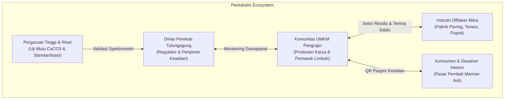
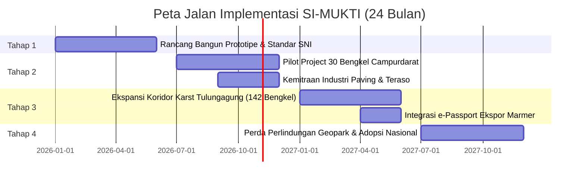

# 🏛️ PRODUCT REQUIREMENT DOCUMENT (PRD)
## SI-MUKTI: Sistem Informasi Geospasial dan Ketertelusuran Digital untuk Valorisasi Limbah serta Peningkatan Daya Saing UMKM Marmer Tulungagung

| Atribut Dokumen | Keterangan |
| :--- | :--- |
| **Nama Produk** | **SI-MUKTI** (*Sistem Informasi Manajemen Spasial dan Rantai Pasok Marmer Menuju Kesejahteraan UMKM Kabupaten Tulungagung Inklusif*) |
| **Inisiator & Pengusul** | Tim Salma Azzahra — Universitas Negeri Medan (LKTIN UNIMED 2026) |
| **Subtema LKTIN** | Digitalisasi Ekonomi, UMKM, dan Pemberdayaan Daerah 3T untuk Ketahanan Ekonomi Nasional |
| **Target Sentra** | Kawasan Industri Marmer Rakyat Kecamatan Campurdarat & Besole, Kabupaten Tulungagung |
| **Versi Dokumen** | Versi 1.0 (Final Architecture & Design Baseline) |
| **Status Dokumen** | Disetujui untuk Implementasi & Uji Lapangan |
| **Desain Sistem** | *Tatah Mineral* (Google Stitch & Figma-Ready) |

---

## 1. Executive Summary & Visi Produk

### 1.1 Latar Belakang & Paradoks Industri
Kabupaten Tulungagung merupakan sentra industri batu marmer alam terbesar di Indonesia dengan pusat pengrajin rakyat terkonsentrasi di Kecamatan Campurdarat dan Besole. Industri ini menyerap ribuan tenaga kerja lokal dan telah menjadi identitas budaya turun-temurun selama lebih dari satu abad. Namun, di balik nilai ekonominya yang tinggi, sektor UMKM marmer menghadapi dua krisis struktural yang mengancam keberlanjutannya:
1. **Krisis Lingkungan & Biaya Residu Limbah:** Proses pembubutan, pemotongan, dan pengasahan marmer menghasilkan residu limbah masif berkisar **25% hingga 30%** dari total bobot bongkahan mentah, berupa serbuk lumpur basah (*sludge* kalsium) dan pecahan batu kasar (*afur*). Kurangnya saluran distribusi membuat limbah mengendap di sempadan sungai atau pengrajin harus menanggung beban biaya pembuangan sebesar **Rp 150.000 – Rp 250.000 per ritase truk**.
2. **Krisis Disrupsi Pasar Marmer Sintetis:** Maraknya serbuan marmer tiruan berbahan resin sintetis impor berharga murah menggerus pangsa pasar marmer lokal. Konsumen kesulitan membedakan batu marmer alam asli Tulungagung dengan batu komposit resin buatan pabrik karena ketiadaan sistem verifikasi keaslian (*product traceability*).

### 1.2 Visi Solusi: Platform SI-MUKTI
**SI-MUKTI** hadir sebagai platform terpadu yang memadukan dua pilar teknologi: **Web-Geographic Information System (Web-GIS)** dan **Dynamic Digital Traceability berbasis Quick Response (QR) Code**. Sistem ini mentransformasi residu limbah pengrajin menjadi komoditas ekonomi sirkular bernilai jual tinggi (diserap oleh industri *paving block*, teraso, dan pupuk kalsium), sekaligus melindungi martabat batu marmer Tulungagung melalui penerbitan paspor digital produk (*Digital Product Passport*) yang tersertifikasi secara geologis.

---

## 2. Analisis Pengguna & Pemangku Kepentingan (Pentahelix)



### 2.1 Persona Pengguna

#### Persona 1: Pak Supardi (Pengrajin Bubut & Pahat Marmer)
* **Demografi:** 52 tahun, Pemilik Bengkel Marmer Al-Barokah, Desa Gamping, Campurdarat.
* **Perilaku Digital:** Pengguna smartphone Android kelas pemula-menengah, aktif WhatsApp, tidak terbiasa dengan antarmuka aplikasi perbankan yang rumit.
* **Kebutuhan Utama:** 
  * Ingin limbah lumpur di bengkelnya cepat diangkut tanpa perlu membayar ongkos buang.
  * Ingin membuktikan ke pembeli di Jakarta/Surabaya bahwa meja buatannya adalah 100% batu onyx asli, bukan cor-coran resin sintetis.
* **Pain Point:** Sering kesulitan bernavigasi jika tombol aplikasi terlalu kecil atau teks berbahasa Inggris. Bekerja di bengkel dengan tangan basah atau berdebu.

#### Persona 2: Hendra Wijaya (Manajer Operasional Industri Offtaker)
* **Demografi:** 38 tahun, Manajer Produksi PT Sentosa Teraso & Paving Tulungagung.
* **Kebutuhan Utama:** 
  * Membutuhkan pasokan bahan baku kalsium karbonat (CaCO3) minimal 100–150 ton per bulan dengan kadar kemurnian > 95% dan kelembapan terkontrol (< 20%).
  * Efisiensi rute penjemputan truk dump agar tidak bolak-balik kosong.
* **Pain Point:** Informasi volume limbah antar pengrajin terpencar-pencar dan tidak ada data lokasi akurat.

#### Persona 3: Ir. Bambang Sulistyo (Disperindag Kab. Tulungagung)
* **Demografi:** 46 tahun, Kepala Seksi Pengembangan Industri Logam, Mesin, Tekstil, dan Aneka.
* **Kebutuhan Utama:** Dashboard pemantauan satu pintu (*single source of truth*) persebaran bengkel marmer, neraca timbulan limbah harian, serta pencegahan pembuangan limbah ke Daerah Aliran Sungai (DAS) Ngrowo.

#### Persona 4: Maya Arisanti (Konsumen / Desainer Interior Mewah)
* **Demografi:** 34 tahun, Arsitek & Interior Designer di Surabaya.
* **Kebutuhan Utama:** Kepastian otentisitas geologis batuan alam bersertifikat SNI untuk proyek residensial mewah klien high-end.

---

## 3. Ruang Lingkup Arsitektur Sistem

Sistem SI-MUKTI beroperasi dalam kerangka kerja *client-server* modular berbasis web dan aplikasi bergerak (*hybrid responsive PWA*):

```
┌─────────────────────────────────────────────────────────────────────────┐
│                        PRESENTATION LAYER                               │
│  [MUKTI-Pengrajin]      [MUKTI-Spasial Web-GIS]      [MUKTI-Trace QR]   │
│   (Mobile PWA / App)      (Desktop GIS Dashboard)     (Landing Web View)│
└────────────────────────────────────┬────────────────────────────────────┘
                                     │ HTTPS / JSON-RPC / REST API
┌────────────────────────────────────▼────────────────────────────────────┐
│                      APPLICATION & BUSINESS LOGIC                       │
│  • Geo-Matching Engine        • AI Volumetric Estimation                │
│  • QR Cryptographic Payload   • Smart Logistics Multi-Stop Optimizer    │
│  • MUKTI-Pay Ledger Service   • Telemetry & Notification Worker         │
└────────────────────────────────────┬────────────────────────────────────┘
                                     │ SQL / Spasial Queries
┌────────────────────────────────────▼────────────────────────────────────┐
│                         DATA PERSISTENCE LAYER                          │
│  PostgreSQL + PostGIS (Spatial Nodes, Workshop Coordinates, Roads, JLS) │
│  Blob Object Storage (Geotagged Waste Photos, Laboratory PDF Certs)     │
└─────────────────────────────────────────────────────────────────────────┘
```

---

## 4. Rincian Kebutuhan Fungsional (Functional Requirements)

### 4.1 Modul 1: MUKTI-Pengrajin (Mobile App)
* **FR-01 (Autentikasi Sederhana):** Pengrajin masuk menggunakan nomor ponsel/WhatsApp melalui One-Time Password (OTP) tanpa password rumit. Profil bengkel otomatis terverifikasi ID Paguyuban.
* **FR-02 (Dashboard Valorisasi Saldo):** Menampilkan akumulasi insentif saldo rupiah dari limbah yang berhasil terdistribusi, tonase limbah terserap, dan jumlah produk aktif berpaspor digital.
* **FR-03 (Pencatatan Residu Limbah):**
  * Pengrajin memilih jenis limbah: *Lumpur Sludge Pemotongan* atau *Bongkahan Afur Kasar*.
  * Input bobot/tonase manual atau estimasi berbasis foto kamera.
  * Perekaman otomatis koordinat geospasial lokasi bengkel (akurasi GNSS < 3 meter).
* **FR-04 (Fitur AI Volumetric Camera Audit):** Kamera smartphone mendeteksi kontur timbunan residu dengan *bounding mesh* dan memperkirakan volume kubikasi ($m^3$) serta konversi tonase berat basah.
* **FR-05 (Pelacakan Penjemputan Real-Time):** Menampilkan status armada truk *offtaker* yang ditugaskan (*Order Diterima* ➔ *Dalam Perjalanan Menuju Bengkel* ➔ *Tiba & Ditimbang* ➔ *Selesai*), dilengkapi estimasi menit kedatangan (ETA) dan tombol kontak telepon/WhatsApp sopir.
* **FR-06 (Dompet MUKTI-Pay & Tarik Dana):** Pengrajin dapat mencairkan saldo valorisasi langsung ke rekening Bank Jatim atau bank nasional lainnya bebas biaya administrasi.

---

### 4.2 Modul 2: MUKTI-Spasial (Web-GIS Dashboard)
* **FR-07 (Visualisasi Peta Geospasial):** Menampilkan peta vektor resolusi tinggi kawasan karst Tulungagung Selatan (Kecamatan Campurdarat, Besole, Boyolangu, dan koridor Jalur Lintas Selatan / JLS).
* **FR-08 (Layer Filter Lapisan Multikategori):**
  * Toggle Pin Hijau: Residu lumpur serbuk *sludge* basah (kadar kalsium tinggi).
  * Toggle Pin Kuning/Oranye: Bongkahan pecahan batu kasar (*afur*).
  * Toggle Pin Ungu: Lokasi pabrik pengolah (*offtaker* semen, teraso, paving).
  * Slider Radius Pengambilan: Filter radius logistik 0 hingga 15 km dari pusat sentra.
  * Filter Kadar Kalsium: Opsi menampilkan residu dengan kemurnian kalsit $\text{CaCO}_3 > 95\%$.
* **FR-09 (Modal Detail Pin Bengkel):**
  * Menampilkan identitas bengkel, nama penanggung jawab, koordinat RTK, dan foto audit volumetrik residu terbaru.
  * Kartu Hasil Uji Laboratorium SNI 03-0394: Kadar $\text{CaCO}_3$, kadar air (*moisture* %), dan tingkat keasaman (pH).
  * Kalkulasi nilai transaksi limbah secara instan (Tonase $\times$ Tarif Kesepakatan).
  * Tombol Aksi: *"Jadwalkan Armada Truk Offtaker"* dan *"Cetak Surat Jalan Digital (e-Manifest)"*.
* **FR-10 (Batch Route Logistics Planning):** Sistem merekomendasikan rute penjemputan multi-titik (*multi-stop vehicle routing*) bagi truk *dump offtaker* untuk mengangkut limbah dari 3–5 bengkel terdekat dalam satu jalur efisien.
* **FR-11 (Panel Telemetri & Analitik Pemda):** Grafik batang mingguan neraca timbulan limbah versus volume penyerapan industri serta pelacak jejak karbon ($\text{CO}_2$ eq) yang berhasil direduksi.

---

### 4.3 Modul 3: MUKTI-Trace (Paspor Digital & Autentikasi QR)
* **FR-12 (Generator Paspor Digital):** Pengrajin menginput nama produk, foto karya jadi, kategori produk, dimensi, serta nomor seri blok batu kuari asal.
* **FR-13 (Kalkulator Kontribusi Sirkular Zero-Waste):** Menghitung porsi residu yang dihasilkan dari pembubutan produk tersebut dan membuktikan bahwa residu tersebut telah terserap $100\%$ melalui MUKTI-Spasial.
* **FR-14 (Penerbitan Stiker QR Code Fisik):** Menghasilkan stiker QR tahan cuaca berstempel pengesahan geologis Pemkab Tulungagung dengan *hash* kriptografis unik yang anti-duplikasi (*tamper-proof*).
* **FR-15 (Landing Page Verifikasi Publik):** Saat kode QR dipindai oleh kamera gawai konsumen tanpa instalasi aplikasi, halaman web menyajikan:
  * Lencana centang hijau: *"PRODUK TERVERIFIKASI ASLI - 100% Batu Alam Marmer Tulungagung"*.
  * Nomor Registrasi Sertifikat resmi dan tanggal terbit.
  * Profil lengkap pengrajin lokal pembuat karya (foto, nama, pengalaman mengukir).
  * Data uji laboratorium: Spektrometri kalsit $\text{CaCO}_3 \ge 98\%$, serat karang tembus pandang (*translucent veining*), dan perbandingan dengan sifat marmer sintetis tiruan.
  * Linimasa perjalanan material (*Traceability Timeline*): Kuari tambang ➔ Bengkel bubut ➔ Uji mutu laboratorium ➔ Konsumen.
  * Tombol interaksi: *"Unduh e-Passport Resmi (PDF)"* dan *"Hubungi Pengrajin untuk Pesanan Kustom (WhatsApp)"*.

---

## 5. Kebutuhan Non-Fungsional (Non-Functional Requirements)

| Kategori | Parameter Kebutuhan | Spesifikasi Standar |
| :--- | :--- | :--- |
| **Usability & UX** | Kemudahan Akses Pengrajin | Ukuran tombol *tap-target* minimal **48–52 px**, kontras warna rasio **WCAG 2.1 AA (> 4.5:1)** agar terbaca jelas di bawah terik matahari bengkel. |
| **Performance** | Kecepatan Muat Peta & QR | Waktu pemuatan tile peta Web-GIS **< 1.8 detik** pada jaringan 4G pedesaan. Pemuatan sertifikat paspor QR **< 0.8 detik**. |
| **Reliability** | Ketersediaan Sistem (Uptime) | Tingkat ketersediaan sistem **99.5%** dengan toleransi sinkronisasi data luring (*offline-first caching*) saat koneksi terputus di area tambang. |
| **Security** | Integritas Sertifikat Digital | Enkripsi payload sertifikat menggunakan **SHA-256** dan *signed payload token* untuk mencegah pemalsuan kode QR oleh pihak luar. |
| **Portability** | Lintas Perangkat | Kompatibel penuh pada Android (Chrome), iOS (Safari), dan Desktop Browser (Edge/Chrome/Firefox). |

---

## 6. Desain Sistem & Standar Antarmuka (*Tatah Mineral*)

Semua antarmuka dibangun mengikuti bahasa visual **"Tatah Mineral"** yang merefleksikan soliditas batu alam Tulungagung dipadukan dengan nilai-nilai keberlanjutan:

```
[ Palet Warna Resmi Tatah Mineral ]
• Primary (Marble Blue)     : #1E3A8A  (Ketegasan industri & formalitas pemda)
• Primary Dark (Navy Quarry): #00236F  (Bilah navigasi & kontras tinggi)
• Eco Accent (Circular Green): #10B981  (Simbol ekonomi sirkular & saldo cair)
• Eco Subtle (Badge Green)  : #ECFDF5  (Latar lencana uji SNI lolos uji)
• Surface Canvas            : #F8FAFC  (Putih marmer Carrara, nyaman di mata)
• Surface Card              : #FFFFFF  (Slab polesan dengan border halus #E2E8F0)
• Gold Authenticity Seal    : #D97706  (Stempel resmi keaslian geologis)
```

### 6.1 Tipografi & Keterbacaan:
* **Display & Headings:** `Plus Jakarta Sans` (Bobot Bold 700 / Semi-Bold 600) — geometri tegas, mudah dibaca cepat.
* **Metrik & Numerik Data:** `Inter` (Tabular Numbers) — memastikan kolom koordinat GPS, berat tonase, dan nominal rupiah tersusun lurus vertikal.

---

## 7. Model Dampak Ekonomi & Lingkungan

### 7.1 Proyeksi Valorisasi Ekonomi Sentra Campurdarat (Skala 100 Bengkel)
* Asumsi timbulan rata-rata limbah padat & lumpur: **2 ton / bulan / bengkel**.
* Total potensi pasokan residu agregat terpetakan: **200 ton / bulan**.

$$\text{Beban Biaya Pembuangan Konvensional} = 100 \times \text{Rp } 200.000 = \text{Rp } 20.000.000/\text{bulan}$$

$$\text{Pendapatan Baru Valorisasi (Tarif Rp } 150.000/\text{ton)} = 200 \times \text{Rp } 150.000 = \text{Rp } 30.000.000/\text{bulan}$$

$$\mathbf{\text{Surplus Perputaran Modal Sentra}} = \text{Rp } 20.000.000 + \text{Rp } 30.000.000 = \mathbf{\text{Rp } 50.000.000/\text{bulan}}$$

### 7.2 Proyeksi Manfaat Lingkungan (Environmental ROI):
* **Zero Dumping DAS Ngrowo:** Mencegah pengendapan sekitar **2.400 ton serbuk kalsium per tahun** ke saluran irigasi dan sungai persawahan warga.
* **Pereduksian Jejak Karbon:** Menekan emisi karbon logistik pengangkutan agregat luar kota sebesar **-38.2% $\text{CO}_2$ eq** melalui pencocokan pasar lokal terdekat (*hyperlocal circular matchmaking*).

---

## 8. Peta Jalan Implementasi (24-Month Strategic Roadmap)



* **Tahap 1 (Bulan 1–6): Rancang Bangun & Pengujian Prototipe Laboratorium**
  * Finalisasi arsitektur web-spasial, API QR kriptografis, dan standarisasi uji spektrometri mutu residu kalsium bersama Balai Standardisasi Jawa Timur.
* **Tahap 2 (Bulan 7–12): Pilot Testing Lapangan (Sentra Campurdarat)**
  * Uji coba operasional pada 30 bengkel percontohan dan kemitraan pasokan bahan baku dengan pabrik paving/teraso lokal Tulungagung.
* **Tahap 3 (Bulan 13–18): Skalabilitas Koridor Karst Selatan (142 Bengkel)**
  * Integrasi penuh seluruh kluster bengkel di Campurdarat dan Besole, adopsi modul armada truk *dump*, dan penyematan sertifikat QR pada produk ekspor.
* **Tahap 4 (Bulan 19–24): Institusionalisasi Regulasi & Replikasi Nasional**
  * Penerbitan Peraturan Daerah (Perda) Tata Kelola Limbah Karst Tulungagung dan replikasi model ke sentra batu alam nasional lainnya (Padalarang, Citatah, dan Pangkep).

---

## 9. Matriks Mitigasi Risiko

| Kategori Risiko | Potensi Dampak | Rencana Mitigasi Solutif |
| :--- | :--- | :--- |
| **Literasi Digital Rendah** | Pengrajin enggan mencatat data residu ke aplikasi | Menyediakan antarmuka ultra-sederhana berbasis foto, asistensi langsung oleh kader paguyuban sentra, serta pencatatan manual via bot WhatsApp. |
| **Kadar Air Sludge Tinggi** | Industri pembeli menolak residu karena terlalu becek | Menyediakan bak sedimentasi terpal percontohan berbiaya murah agar lumpur mengering dalam 24 jam sebelum dijemput armada. |
| **Pemalsuan Kode QR** | Pedagang marmer sintetis mencetak QR palsu | Menerapkan tanda tangan digital kriptografis (*Signed Hash JWT*) yang hanya dapat diverifikasi melalui domain resmi pemerintah daerah `tulungagung.go.id`. |
| **Fluktuasi Permintaan Pabrik** | Pasokan limbah menumpuk saat proyek konstruksi sepi | Diversifikasi industri penyerap ke sektor pertanian (sebagai bahan kapur pertanian/dolomit penurun keasaman tanah persawahan). |

---

## 10. Dokumen Pendukung & Tautan Repositori

* **Naskah Lengkap KTI Word:** [`Draft_Naskah_LKTIN_SI-MUKTI_UNIMED2026.docx`](file:///c:/Users/ALVIN/Downloads/LKTIN%20TIM%20Salma/Draft_Naskah_LKTIN_SI-MUKTI_UNIMED2026.docx)
* **Showcase Prototipe Interaktif:** [`interactive_prototype_showcase.html`](file:///c:/Users/ALVIN/Downloads/LKTIN%20TIM%20Salma/interactive_prototype_showcase.html)
* **Aset Mockup Resolusi Tinggi:** Folder [`prototype_assets/`](file:///c:/Users/ALVIN/Downloads/LKTIN%20TIM%20Salma/prototype_assets/)
* **Token Desain Figma:** [`figma_tokens.json`](file:///c:/Users/ALVIN/Downloads/LKTIN%20TIM%20Salma/prototype_assets/figma_tokens.json)
